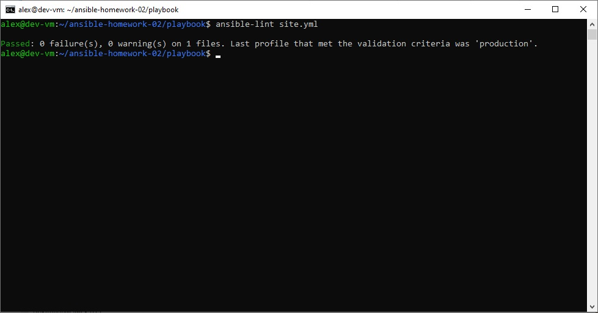
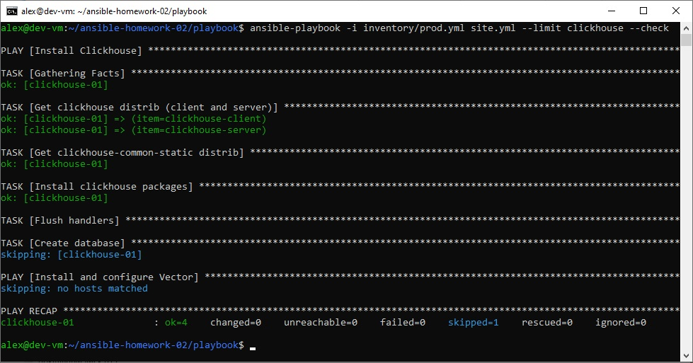
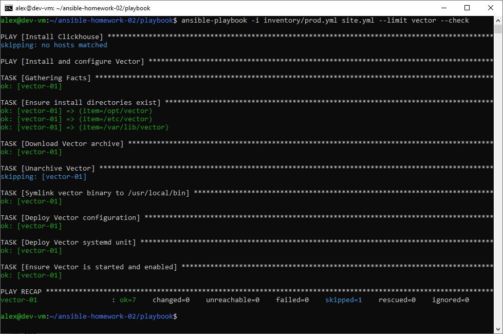
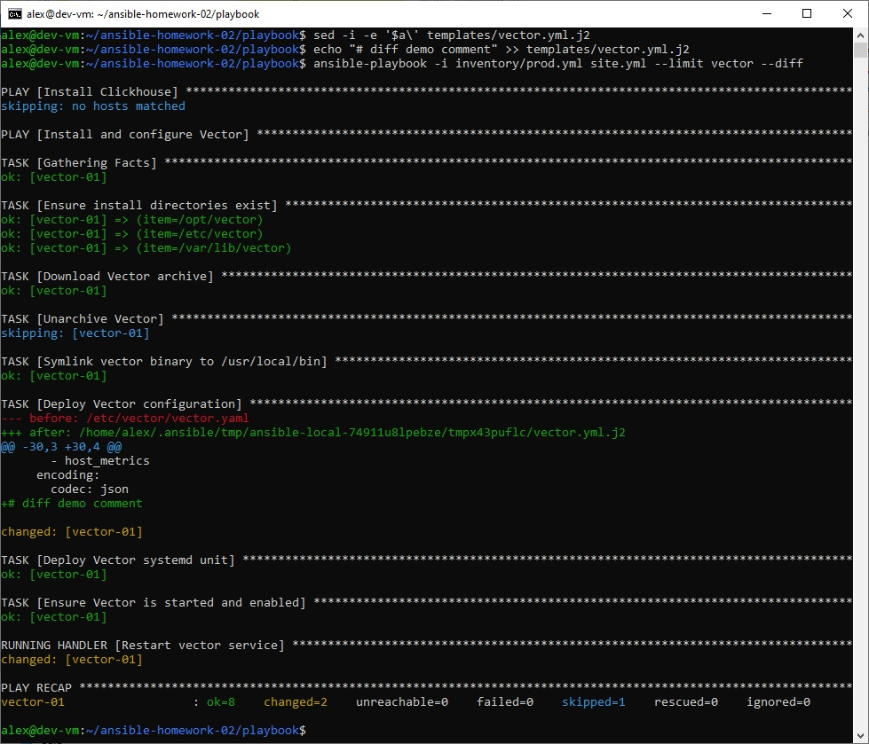
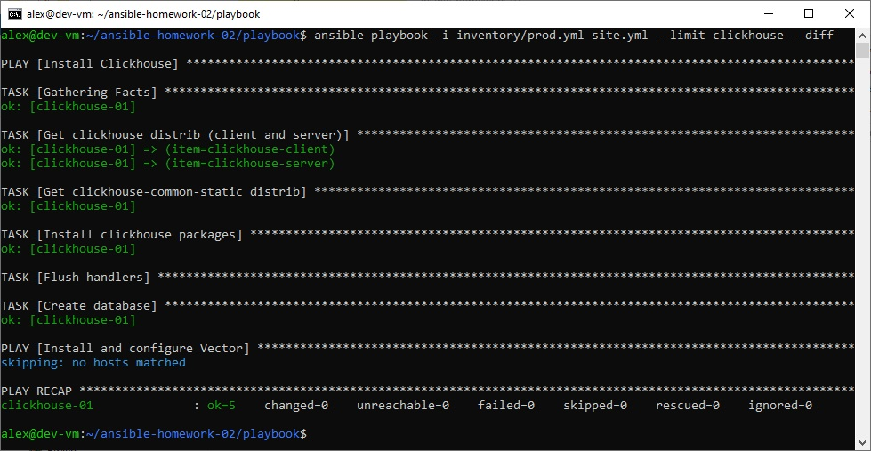
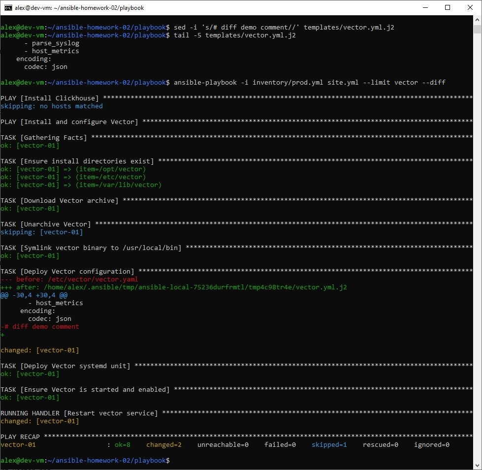
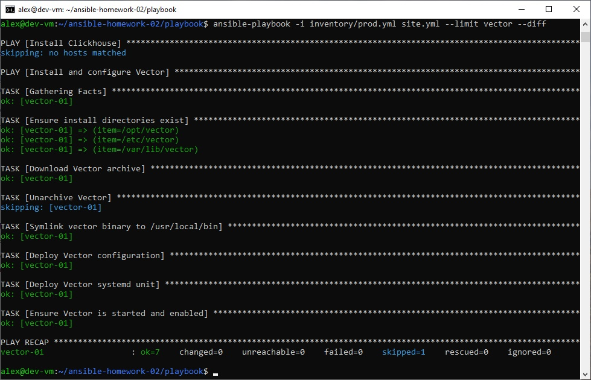

# Домашнее задание к занятию 2 «Работа с Playbook»

## 📖 О чём этот playbook

Playbook автоматизирует установку и настройку двух сервисов на серверах под управлением **Rocky Linux 9**:

- **ClickHouse** — установка из официальных RPM-пакетов, запуск сервиса, создание базы данных `logs`.
- **Vector** — скачивание дистрибутива с GitHub Releases, распаковка, установка бинарника, деплой конфигурации через Jinja2-шаблон и запуск как systemd-сервис.

Playbook написан в соответствии с требованиями задания: используются модули `get_url`, `unarchive`, `file`, `template`, `systemd`; конфигурация Vector деплоится через шаблон Jinja2; при изменении конфигурации или unit-файла срабатывает handler и перезапускает Vector.

## 📂 Структура репозитория

```
ansible-homework-02/
├── README.md
├── images/                          # скриншоты выполнения (п. 5–8)
├── playbook/
│   ├── site.yml                     # основной playbook (2 play: ClickHouse, Vector)
│   ├── inventory/
│   │   └── prod.yml                 # inventory с хостами
│   ├── group_vars/
│   │   ├── clickhouse/
│   │   │   └── vars.yml             # версия и пакеты ClickHouse
│   │   └── vector/
│   │       └── vars.yml             # версия, URL, пути установки Vector
│   └── templates/
│       ├── vector.yml.j2            # шаблон конфигурации Vector
│       └── vector.service.j2        # шаблон systemd-unit
└── .gitignore
```

## 🖥️ Окружение

- **Control node:** Debian 13, Ansible установлен через `sudo apt install ansible` (`ansible-core` 2.19+).
- **Managed hosts:** две VM в Yandex Cloud на Rocky Linux 9:
  - `clickhouse-01` — группа `clickhouse`;
  - `vector-01` — группа `vector`.
- Доступ к ВМ по SSH с ключом `~/.ssh/id_ed25519`.

## 📝 Inventory (`playbook/inventory/prod.yml`)

```yaml
---
all:
  children:
    clickhouse:
      hosts:
        clickhouse-01:
          ansible_host: <IP_CLICKHOUSE>
          ansible_user: alex
          ansible_ssh_private_key_file: ~/.ssh/id_ed25519
    vector:
      hosts:
        vector-01:
          ansible_host: <IP_VECTOR>
          ansible_user: alex
          ansible_ssh_private_key_file: ~/.ssh/id_ed25519
```

## ⚙️ Параметры (переменные)

### ClickHouse (`playbook/group_vars/clickhouse/vars.yml`)

| Переменная | Описание | Значение |
|---|---|---|
| `clickhouse_version` | Версия ClickHouse | `"24.8.5.115"` |
| `clickhouse_packages` | Список пакетов для установки | `[clickhouse-client, clickhouse-server, clickhouse-common-static]` |

### Vector (`playbook/group_vars/vector/vars.yml`)

| Переменная | Описание | Значение |
|---|---|---|
| `vector_version` | Версия Vector | `"0.61.0"` |
| `vector_archive` | Имя архива | `vector-{{ vector_version }}-x86_64-unknown-linux-gnu.tar.gz` |
| `vector_download_url` | URL для скачивания | `https://github.com/vectordotdev/vector/releases/download/v{{ vector_version }}/{{ vector_archive }}` |
| `vector_install_dir` | Каталог установки | `/opt/vector` |
| `vector_bin` | Путь к бинарнику после распаковки | `{{ vector_install_dir }}/vector-x86_64-unknown-linux-gnu/bin/vector` |

> 💡 Обратите внимание: имя каталога после распаковки (`vector-x86_64-unknown-linux-gnu`) **не содержит версию** — это важно для корректной работы `unarchive` + `creates`.

## 🏷️ Теги

Playbook поддерживает теги для выборочного выполнения задач:

| Тег | Что выполняется |
|---|---|
| `clickhouse` | Все задачи play для ClickHouse |
| `vector` | Все задачи play для Vector |
| `install` | Задачи установки (скачивание, распаковка, создание каталогов/симлинков) |
| `configure` | Задачи настройки (деплой конфигов, создание БД, запуск сервисов) |

**Примеры:**

```bash
# Только ClickHouse
ansible-playbook -i inventory/prod.yml site.yml --tags clickhouse

# Только установка (без конфигурации)
ansible-playbook -i inventory/prod.yml site.yml --tags install

# Только настройка Vector
ansible-playbook -i inventory/prod.yml site.yml --tags vector,configure

# Всё, кроме конфигурации
ansible-playbook -i inventory/prod.yml site.yml --skip-tags configure
```

## 🚀 Использование

### 1. Подготовка inventory

Отредактируйте `playbook/inventory/prod.yml`, указав IP-адреса ваших ВМ.

### 2. Проверка синтаксиса и линтинг

```bash
cd playbook
ansible-lint site.yml
```

Ожидаемый результат: `Passed: 0 failure(s), 0 warning(s)`.

### 3. Пробный запуск (`--check`)

```bash
ansible-playbook -i inventory/prod.yml site.yml --check
```

Ничего не изменяет — показывает, что было бы сделано.

### 4. Запуск с отображением диффа (`--diff`)

```bash
ansible-playbook -i inventory/prod.yml site.yml --diff
```

Показывает изменения в файлах (особенно для задач `template`).

### 5. Полный запуск

```bash
ansible-playbook -i inventory/prod.yml site.yml
```

### 6. Проверка состояния на хостах

```bash
# ClickHouse
ssh alex@<IP_CLICKHOUSE> "sudo systemctl status clickhouse-server --no-pager; clickhouse-client -q 'show databases;'"

# Vector
ssh alex@<IP_VECTOR> "sudo systemctl status vector --no-pager; vector validate /etc/vector/vector.yaml"
```

## 🔍 Что делает playbook

### Play 1. Install ClickHouse (`hosts: clickhouse`)

1. Скачивает RPM-пакеты `clickhouse-client`, `clickhouse-server`, `clickhouse-common-static` нужной версии через `get_url`.
2. Устанавливает их через `dnf` (с `disable_gpg_check: true`, поскольку пакеты ClickHouse не подписаны).
3. Через handler `Start clickhouse service` перезапускает `clickhouse-server`.
4. Создаёт базу данных `logs` (задача идемпотентна: `failed_when: rc not in (0, 82)`, `changed_when: rc == 0`).

### Play 2. Install and configure Vector (`hosts: vector`)

1. Создаёт каталоги `/opt/vector`, `/etc/vector`, `/var/lib/vector` через `file`.
2. Скачивает архив Vector с GitHub Releases через `get_url` в `/tmp/`.
3. Распаковывает архив в `/opt/vector` через `unarchive` (`remote_src: true`, `creates: {{ vector_bin }}` — идемпотентность).
4. Создаёт симлинк `/usr/local/bin/vector → {{ vector_bin }}` через `file`.
5. Деплоит конфигурацию `/etc/vector/vector.yaml` из шаблона `templates/vector.yml.j2` через `template` (notify → `Restart vector service`).
6. Деплоит systemd-unit `/etc/systemd/system/vector.service` из шаблона `templates/vector.service.j2` через `template` (notify → `Restart vector service`).
7. Убеждается, что сервис запущен и включён в автозагрузку через `systemd`.

**Handler `Restart vector service`** срабатывает только при фактическом изменении конфига или unit-файла — это обеспечивает идемпотентность.

### Конфигурация Vector (`templates/vector.yml.j2`)

Стандартный конфиг: сбор метрик хоста (`host_metrics`: CPU, диск, память, сеть) и логов (`/var/log/messages`, `/var/log/secure`), парсинг syslog и вывод в консоль JSON. Sink `console` можно заменить на отправку логов в ClickHouse/Elasticsearch и т.д.

## 🖼️ Скриншоты выполнения заданий №5–8

### Пункт 5. `ansible-lint site.yml` — 0 ошибок



### Пункт 6. `--check` — ClickHouse



### Пункт 6. `--check` — Vector



### Пункт 7. `--diff` — Vector (изменён шаблон, `changed=2`, виден дифф)



### Пункт 8. Идемпотентность — ClickHouse (`changed=0`)



### Пункт 8. Идемпотентность — Vector (`changed=0`, `skipped=1`, handler не запущен)





## ✅ Идемпотентность

Playbook идемпотентен: повторный запуск не вносит изменений в систему.

- `get_url` не перекачивает существующие файлы (если размер/checksum совпадают).
- `unarchive` с `creates: {{ vector_bin }}` пропускает распаковку, если бинарник уже есть (`skipped=1`).
- `file` для каталогов и симлинка идемпотентен по природе.
- `template` не помечает задачу `changed`, если содержимое файла не изменилось.
- `command` для создания БД имеет `failed_when`/`changed_when`, которые корректно обрабатывают код 82 (база уже существует).
- Handler `Restart vector service` срабатывает **только** при изменении конфига/unit.

Проверено: повторный запуск с `--diff` даёт `changed=0` для обоих хостов.

## 📋 Требования

- Ansible 2.10+ (`ansible-core` 2.19 проверен).
- `ansible-lint` (для проверки синтаксиса).
- SSH-доступ к управляемым хостам.
- Python 3 на управляемых хостах (Rocky Linux 9 — Python 3.9 по умолчанию).
- Доступ в интернет с управляемых хостов (`packages.clickhouse.com`, `github.com`).

## 📌 Примечания и известные особенности

- **ClickHouse RPM не подписаны** — используется `disable_gpg_check: true` в задаче `dnf`. Альтернатива — импорт ключа ClickHouse, но для учебной задачи достаточно отключить проверку.
- **Vector `unarchive`** использует каталог без версии в имени (`vector-x86_64-unknown-linux-gnu`) — это особенность архивов Vector с GitHub Releases. Переменная `vector_bin` учитывает это.
- **`vector validate`** в версии 0.61.0 не принимает флаг `--config` — используйте позиционный аргумент: `vector validate /etc/vector/vector.yaml` или `vector validate --config-dir /etc/vector/`.

## 📤 Ссылка на решение

- **Репозиторий:** https://github.com/akamsoft/ansible-homework-02
- **Тег:** https://github.com/akamsoft/ansible-homework-02/releases/tag/08-ansible-02-playbook
